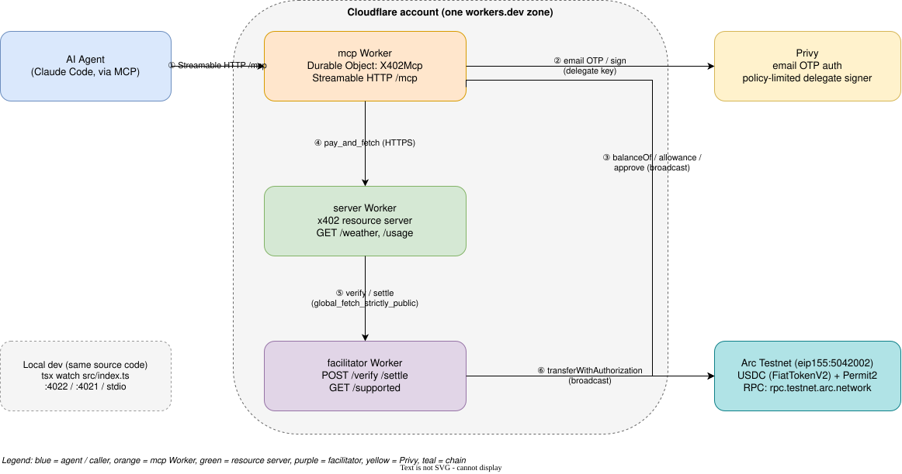
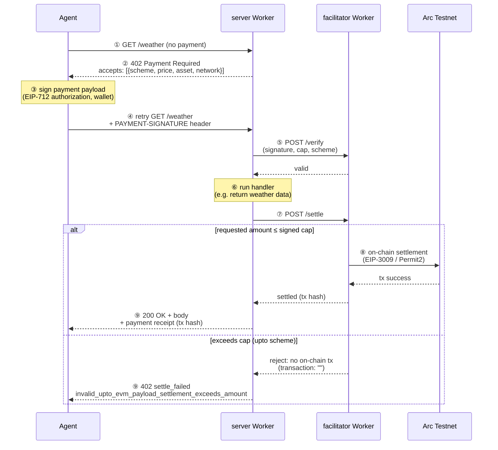

# devcon8-workshop

This repo for devcon8 workshop: Building an x402-Powered AI Agent: Autonomous Micropayments with Cloudflare Workers 

## Demo Video

[here](https://youtu.be/r14kL3AlfdE)

## Workshop Guide

[Read here](./docs/workshop.md)

## Architecture

Three independent services (facilitator, resource server, MCP server) that run either as local Node processes or as Cloudflare Workers from the same source, plus Privy for wallet auth/signing and Arc Testnet for settlement.

**Why Arc, not Base/Ethereum mainnet?** Arc is Circle's own EVM-compatible Layer 1 — a standalone chain with its own consensus and settlement, not an Ethereum L2/rollup — purpose-built for stablecoin finance: USDC as the native gas asset and sub-second deterministic finality. Being EVM-compatible means everything here (viem, EIP-712 typed-data signing, EIP-3009 `transferWithAuthorization`, Solidity-style token contracts) is the same tooling any Ethereum/Base x402 integration would use; the application flow can be reused across supported EVM chains. Migration also requires checking the token's EIP-712 domain and decimals, scheme contract availability, gas funding, and any existing Privy wallet policies; it is not just an address change.

Editable source: [`docs/diagrams/architecture.drawio`](docs/diagrams/architecture.drawio) (open in [diagrams.net](https://app.diagrams.net) or the [VS Code Draw.io Integration](https://marketplace.visualstudio.com/items?itemName=hediet.vscode-drawio) extension).

### x402 payment flow

The `exact` scheme (`/weather`) and the `upto` scheme (`/usage?units=N`) both go through the same 402 → sign → verify → settle cycle. The `else` branch below is the `upto` over-cap case, verified against the live deployment: the facilitator rejects settlement before any on-chain transaction, so no funds move.

