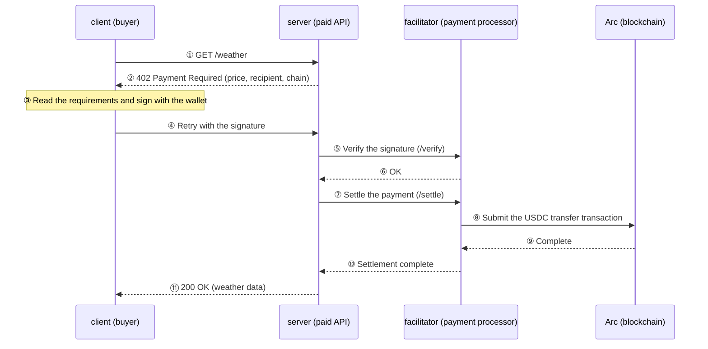

# x402 x Arc Hands-on Workshop: Natural-Language AI Agent Payments on Cloudflare Workers

## What You Will Build

In this workshop, you will build a system where **you can ask an AI agent in natural language to use a paid API, and it will automatically pay for and retrieve the data**.

We will use the following technologies:

| Technology | Role |
|---|---|
| **x402** | An API payment protocol built around HTTP `402 Payment Required` |
| **Arc Testnet** | The blockchain used for settlement; both gas and payments are paid in USDC |
| **Privy** | Creates an AI agent wallet through email login |
| **Cloudflare Workers** | Hosts the three servers |
| **MCP** | Lets AI agents such as Claude Code access the wallet and payment features |

You will build these **four programs**:

| Name | Role |
|---|---|
| **server** | A paid API for data such as weather; returns `402 Payment Required` when payment is missing |
| **facilitator** | Verifies payments and records, or settles, them on the blockchain |
| **client** | Signs and pays after receiving a 402, then calls the API again for local testing |
| **mcp** | Provides a natural-language interface for AI agent payments and manages the wallet |

> 💡 Think of the server as the store, the facilitator as the payment terminal and cashier, the client as the buyer, and the MCP server as the AI agent shopping on the buyer's behalf.

### Workshop flow

We will first understand the x402 flow locally, deploy the same system to the cloud, and finally use it through an AI agent.

> The time estimates are guidelines only.

| Step | Activity | Goal | Estimated time |
|---|---|---|---|
| 1. Setup | Install dependencies and create configuration files | Prepare the system to run | 10 minutes |
| 2. Local validation | Run three programs on your computer and make a payment | Understand the x402 mechanism locally | 10 minutes |
| 3. Deployment | Deploy three programs to Cloudflare Workers | Create publicly accessible servers | 10 minutes |
| 4. Natural-language payment | Pay through MCP from Claude Code | Let an AI agent handle money safely | 4 minutes |
| 5. Cleanup | Delete deployed resources | Avoid leaving ongoing costs or maintenance | 1 minute |

We will use the **Arc Testnet**, so no real money is involved, and use **Privy** for wallets. The instructions use **Claude Code**, but you can register the same URL with another AI agent that supports MCP over Streamable HTTP, such as **Codex**.

## What Is x402?

x402 is a protocol that uses the long-established but rarely used HTTP **`402 Payment Required`** status code to let clients **pay for API access at request time**. It requires no membership registration or API key, and both people and **AI agents can pay automatically**.

The payment flow works as follows:



There are three important points:

- **The server never interacts with the blockchain.** It delegates verification and settlement to the facilitator.
- **The client only signs.** The signature authorizes payment up to the specified amount.
- The **402 response contains the price and terms**, so the client learns how to pay at request time without a prior contract or registration.

In this workshop, you will examine this flow in order: **experience it locally -> deploy it to the cloud -> delegate it to an AI agent**.

## What You Will Learn

By completing this workshop, you will understand:

- The x402 scheme
- How to deploy the resources required for x402 to Cloudflare Workers
- How to configure an arbitrary chain and asset
  - This workshop uses USDC on Arc Testnet, but the code also shows how to configure other chains and assets.
- How to make x402 payments through natural language

## Prerequisites

- An editor such as VS Code is installed
- A Claude Code Pro plan or higher
- Git is installed
- A GitHub account
- A Privy account and app with **Email login enabled**
- A Cloudflare account; the free Workers plan is sufficient
- Node.js **v22 or later** and pnpm; Wrangler, used for Workers deployment, requires Node 22 or later
- MetaMask, used to create test wallets and obtain private keys
- For instructors: if many participants on the same venue Wi-Fi will use the same MCP server, adjust the rate limit in advance. See the note for MCP in step 3 of the deployment section.

> You do not need to install the Wrangler CLI globally. It is included as a repository dependency and run with `pnpm --filter <package-name> exec wrangler`.

## Setup

### Install dependencies

This workshop is a pnpm workspace containing multiple packages: client, server, facilitator, MCP, and config. Install all package dependencies together from the project root:

```bash
pnpm install
```

### Configure environment variables

Private keys, URLs, and other settings belong in environment-variable files such as `.env`, not directly in the source code. First, copy each package's `*.example` template to create your own files:

```bash
pnpm run setup
```

This command creates the following eight environment-variable files:

```bash
pkgs/client/.env
pkgs/server/.env
pkgs/server/.dev.vars
pkgs/facilitator/.env
pkgs/facilitator/.dev.vars
pkgs/mcp/.env
pkgs/mcp/.dev.vars
pkgs/config/.env
```

### Verify the configuration

Before continuing, confirm that the setup is correct. If type checking succeeds for every package, the dependencies and initial configuration are ready:

```bash
pnpm -r run cf:typecheck
```

If every package finishes without errors, setup is complete.

> 💡 Do not run `pnpm run -r build` immediately after the first clone. The server and MCP builds depend on files generated by `wrangler types`, so they will fail. `cf:typecheck` runs generation and type checking together.

## Local Validation

**The goal of this section is to experience the complete x402 payment flow on your computer: 402 -> signature -> settlement.**

When a system is deployed to the cloud immediately, failures can be difficult to diagnose. We will first run the three local components—**client, server, and facilitator**—to understand the flow.

| Component | Role | Port |
|---|---|---|
| facilitator | Verifies payments and performs on-chain settlement | 4022 |
| server | Provides paid APIs such as `/weather` and returns 402 when unpaid | 4021 |
| client | Signs, pays, and retries after receiving a 402 | - |

### 1. Enter environment-variable values

Because the next steps transfer funds on-chain, you need addresses for the **payer, settlement submitter, and recipient**. Add the following values to the `.env` files created by `pnpm run setup`:

| File | Variable | Value |
|---|---|---|
| `pkgs/config/.env` | `PAYEE_ADDRESS` | Payment recipient address—your wallet address |
| `pkgs/facilitator/.env` | `EVM_PRIVATE_KEY` | Private key for the wallet that submits settlement transactions and pays gas |
| `pkgs/client/.env` | `EVM_PRIVATE_KEY` | Private key for the wallet that pays |

Copy the private keys from **MetaMask**:

1. Create two **new accounts dedicated to this workshop** in MetaMask, for example `x402-client` and `x402-facilitator`.
2. For each account, open **︙ (Account details) -> Show private key**, enter your password, and copy the private key.
3. Put the client account's private key in `pkgs/client/.env` and the facilitator account's private key in `pkgs/facilitator/.env` as `EVM_PRIVATE_KEY`. Use the format beginning with `0x`.
4. Set `PAYEE_ADDRESS` to a recipient address **different from the client address**. If they are the same, the wallet sends funds to itself and the balance does not clearly demonstrate settlement. Creating one more MetaMask account for the recipient is the easiest option.

> ⚠️ Use private keys from **test-only wallets**. Never enter the private key for your primary wallet. The `.env` files are excluded from Git, but you must also avoid posting their contents in chat or elsewhere.

The chain, token, and pricing are centralized in `pkgs/config/.env`; the defaults use USDC on **Arc Testnet**. Edit this one file to switch to another chain or asset.

### 2. Get testnet USDC

The payer needs USDC, and the facilitator needs gas to submit the settlement transaction. Testnet USDC is available for free.

Open the [Circle Faucet](https://faucet.circle.com/), select **Arc Testnet**, and request USDC for these addresses:

- Client address: at least **2 USDC**
- Facilitator address: a small amount for gas

> USDC is also Arc's gas token, so you do not need a separate gas token.

### 3. Start the facilitator and server

The server asks the facilitator to verify payments, so start them in the order **facilitator -> server**. Open two terminals:

```bash
# Terminal A
pnpm facilitator run dev
```

```bash
# Terminal B
pnpm x402server run dev
```

Alternatively, start both in the background with one command. Logs are written to `.run/`:

```bash
pnpm start
```

Run `pnpm stop` when you want to stop them.

## Test the Local Deployment

### 1. Confirm the services are running

```bash
curl localhost:4022/supported
curl localhost:4021/health
```

The `/supported` response should list the facilitator's supported payment schemes, `exact` and `upto`, and the network `eip155:5042002`.

### 2. Confirm the unpaid response (HTTP 402)

First, call the paid API without paying:

```bash
curl -i localhost:4021/weather
```

The response should be `HTTP/1.1 402 Payment Required`. The `PAYMENT-REQUIRED` header contains Base64-encoded payment requirements such as the **price, recipient, and chain**. The client reads these values to learn how to pay.

### 3. Pay and retrieve data with the client

```bash
pnpm x402client run dev
```

The client automatically performs steps ③ through ⑪ from the earlier diagram: receive the 402, sign, retry with payment, and retrieve the data. If you see weather data and `Payment settled` with `success: true` and a transaction hash, the payment succeeded. 🎉

You can inspect the transaction in the [Arc Testnet Explorer](https://explorer.testnet.arc.io/).

### 4. Try usage-based payments with the `upto` scheme

The `/weather` route uses **`exact` fixed pricing**, which charges the same amount every time. The `/usage?units=N` route uses the **`upto` usage-based scheme**, settling only the amount for the number of units consumed. The client signs an authorization for a maximum amount, and the server settles only the actual usage.

When AI agents can make payments, safeguards against **overspending** are essential. This step demonstrates those safeguards.

First, set the client's payment budget, which is the USDC allowance granted to Permit2. Without `--execute`, the command is a dry run that only displays the current value:

```bash
pnpm x402client run approve 2000000 --execute
```

Next, run the guardrail scenarios. The facilitator and server must still be running:

```bash
pnpm x402client run guardrails
```

The test succeeds when all three cases report `PASS`:

- A payment within the signed cap, 0.3 USDC, is settled.
- A 1.0 USDC payment above the 0.5 USDC signed cap is rejected.
- A request above the client's `MAX_AMOUNT_PER_PAYMENT` limit is rejected before signing.

This demonstrates how multiple payment limits work together when an AI agent handles money.

Local validation is now complete.

Next, we will deploy the resources to Cloudflare Workers and verify that they work remotely.

## Deploy to Cloudflare Workers

> You need a Cloudflare account for the following steps. You can create one for free if you do not already have one.

**The goal of this section is to publish the three locally tested components and the AI agent's MCP server on Cloudflare Workers.**

Once deployed, the services remain available when your computer is off and can be reached by an AI agent's MCP client.

### 1. Sign in to Cloudflare

```bash
pnpm --filter facilitator exec wrangler login
pnpm --filter facilitator exec wrangler whoami
```

`wrangler login` opens a browser so you can sign in and authorize Cloudflare. Use `whoami` to confirm the destination account. If you have not configured a `workers.dev` subdomain, set one up first in [Workers & Pages](https://dash.cloudflare.com/?to=/:account/workers-and-pages).

### 2. Configure Privy

The MCP server uses email login to create a **wallet dedicated to the AI agent**. Complete the following steps in the [Privy Dashboard](https://dashboard.privy.io):

1. Enable **Email** login.
2. Record the **App ID**, **App Secret**, and **Client ID**.
   - `PRIVY_APP_ID` and `PRIVY_CLIENT_ID` are public values and belong in `vars` in `pkgs/mcp/wrangler.jsonc`. Add `PRIVY_APP_SECRET` as a secret in the next step.
3. Add the deployed MCP Worker's origin to **Allowed origins**, for example `https://x402-arc-mcp.<your-subdomain>.workers.dev`.
   - You can determine the MCP Worker URL before deployment from the Worker name, `x402-arc-mcp`, and your `workers.dev` subdomain.
   - Find the subdomain in the [Workers & Pages](https://dash.cloudflare.com/?to=/:account/workers-and-pages) dashboard. You can also inspect the account with `pnpm --filter facilitator exec wrangler whoami`.
   - Add `http://localhost:5173` as well if you will test locally.
   - Privy rejects login requests from origins not registered in the dashboard. If you skip this step, login fails with `Origin not allowed`.

### 3. Register secrets

Storing private keys and similar values in files such as `wrangler.jsonc` risks exposing them. Store them in Cloudflare's encrypted secret storage instead. Each command prompts you to enter the value directly:

```bash
pnpm --filter facilitator exec wrangler secret put EVM_PRIVATE_KEY
pnpm --filter x402mcp exec wrangler secret put PRIVY_APP_SECRET
```

> ⚠️ `PRIVY_APP_SECRET` has powerful permissions that can create wallets for every user in the app. Never share it or commit it to Git.

The first `wrangler secret put` may ask whether to create the Worker because it does not exist yet. Enter `Y` to continue.

### 4. Deploy in the required order

The server configuration needs the facilitator URL, and the MCP configuration needs the server URL. Because these URLs become available only after deployment, deploy in the order **facilitator -> server -> MCP**.

> ⚠️ Replace **every `<...>` placeholder with your own value** in `pkgs/server/wrangler.jsonc` and `pkgs/mcp/wrangler.jsonc`. Deployment can succeed while placeholders remain, but the Workers will not operate correctly. Before deploying, run the following check. No output means no placeholders remain:
>
> ```bash
> grep -n "<" pkgs/server/wrangler.jsonc pkgs/mcp/wrangler.jsonc | grep -v '\$schema'
> ```

**① Facilitator**

```bash
pnpm deploy:facilitator
```

Record the generated URL, which looks like `https://x402-arc-facilitator.<subdomain>.workers.dev`.

**② Server**

Set `FACILITATOR_URL` in `pkgs/server/wrangler.jsonc` to the URL from step ①, then deploy:

```jsonc
"vars": {
  "FACILITATOR_URL": "https://x402-arc-facilitator.<subdomain>.workers.dev"
}
```

```bash
pnpm deploy:server
```

**③ MCP**

Update the following values in `pkgs/mcp/wrangler.jsonc`, then deploy:

```jsonc
"vars": {
  "PAYWALL_API_BASE_URL": "https://x402-arc-server.<subdomain>.workers.dev", // URL from step ②
  "PRIVY_APP_ID": "<your App ID>",
  "PRIVY_CLIENT_ID": "<your Client ID>",
  "PRIVY_ORIGIN": "https://x402-arc-mcp.<subdomain>.workers.dev" // This MCP Worker's URL
}
```

```bash
pnpm deploy:mcp
```

> 💡 **Rate limits for instructors:** The `ratelimits` setting in `pkgs/mcp/wrangler.jsonc` defaults to 300 requests per 60 seconds for each client IP. On venue Wi-Fi, every participant may appear to use the same IP and share one quota, leading to accidental 429 responses. Plan for about 10–15 requests per person and raise `simple.limit` to at least the number of participants x 15—for example, 750 or more for 50 people. `period` can only be 10 or 60. Also ensure that `namespace_id`, which defaults to `"4021"`, is unique within the Cloudflare account.

> 💡 Always use `pnpm deploy:*`. Running `wrangler deploy` directly does not pass the shared chain, token, and pricing configuration from `pkgs/config/.env` to the Worker, which will then return a 500 error.

## Test the Deployed Services

### 1. Check the facilitator and server

```bash
curl -s https://<facilitator-URL>/supported
curl -s https://<server-URL>/health
curl -s -i https://<server-URL>/weather
```

As with the local services, deployment succeeded if `/supported` returns data and `/weather` returns `402`.

### 2. Register the MCP server with Claude Code

```bash
claude mcp add --transport http x402-arc-remote https://<mcp-URL>/mcp
```

Alternatively, create `.claude/.mcp.json` and register the MCP server there:

```json
{
  "mcpServers": {
    "x402-arc-demo": {
      "type": "http",
      "url": "https://x402-arc-mcp.<subdomain>.workers.dev/mcp"
    }
  }
}
```

Then start Claude Code with this command:

```bash
claude --mcp-config=./.claude/.mcp.json
```

After registration, run `/mcp` in Claude Code to confirm the connection.

### 3. Make x402 payments with natural language

After registering the MCP server, Claude Code can use the following tools. You can create a wallet and make payments entirely through natural-language instructions:

| Tool | Description |
|---|---|
| `wallet_status` | Checks whether a wallet exists, plus its balance and allowance |
| `wallet_login_start` / `wallet_login_verify` | Signs in with a one-time email code and creates a Privy wallet |
| `set_budget` | Sets the payment allowance using a **two-step flow with amount confirmation** |
| `pay_and_fetch` | Accesses and pays for a paid API; only `/weather` and `/usage?units=N` are allowed |

Try giving Claude Code the following prompt:

> Check my wallet status. If I do not have a wallet yet, guide me through signing in by email and creating one.

After the wallet is created, use the [Circle Faucet](https://faucet.circle.com/) to fund the displayed address with USDC on **Arc Testnet**, then ask:

> Set my budget to 2 USDC. Confirm the amount with me before executing. Then perform each of the following in order and report the result:
> 1. Pay for and fetch `/weather` (exact, 0.5 USDC).
> 2. Pay for and fetch `/usage?units=3` (upto, 0.3 USDC).
> 3. Pay for and fetch `/usage?units=10` (upto, 1.0 USDC). What happens when it exceeds the signed cap of 0.5 USDC?

Expected results:

- Steps 1 and 2: settlement succeeds.
- Step 3: the facilitator rejects the request with `invalid_upto_evm_payload_settlement_exceeds_amount`, and **no funds are charged**.

> 💡 The rejection in step 3 is not a failure; it proves that the **guardrail works correctly**. The same mechanism that blocked over-cap settlement locally also protects payments made through the AI agent.

> 💡 Budget approval with `set_budget` always requires human confirmation. The AI agent cannot raise its own payment limit. After the budget is approved once, the agent can pay autonomously within that limit. This is how the system lets an AI agent handle money safely.

### Troubleshooting

| Symptom | What to check |
|---|---|
| `wallet_login_start` fails with `Origin not allowed` | Is the MCP Worker URL registered in **Allowed origins** in the Privy Dashboard? |
| `wallet_login_start` fails with `Must specify origin` | Did you set `PRIVY_ORIGIN` and redeploy the MCP Worker? |
| A Worker returns a 500 error naming a variable | Did you run `wrangler deploy` directly? Use `pnpm deploy:*` instead. |
| The server's request to the facilitator fails with Cloudflare error 1042 | Does `wrangler.jsonc` include `global_fetch_strictly_public` in `compatibility_flags`? |
| `wallet_status` returns `rate limit exceeded` | The Arc public RPC is rate-limiting the request. Wait a few seconds and try again. |
| `invalid_exact_evm_insufficient_balance` | The payer wallet does not have enough USDC. Refill it from the faucet. |

View logs with:

```bash
pnpm --filter <package-name> exec wrangler tail
```

## Cleanup

After validation, complete the following steps so no resources or maintenance work remain.

### 1. Stop the local servers

If you started the services with `pnpm start`, stop them with:

```bash
pnpm stop
```

If you started them directly in terminal windows, press `Ctrl+C` in each terminal.

### 2. Remove the MCP server from Claude Code

```bash
claude mcp remove x402-arc-remote
```

### 3. Delete the deployed Workers

```bash
pnpm --filter facilitator exec wrangler delete
pnpm --filter x402server exec wrangler delete
pnpm --filter x402mcp exec wrangler delete
```

Review and accept the confirmation prompt for each command. When deletion completes, the Workers and their registered secrets are removed from **Cloudflare Workers**.

### 4. Clean up secrets and remaining funds

- Delete test private keys from `pkgs/*/.env` when you no longer need them. Stop using the dedicated MetaMask accounts after the workshop.
- Remove the workshop URL from **Allowed origins** in the Privy Dashboard.
- If you used a Privy app that serves other purposes, rotate its **App Secret** as a precaution.
- Testnet USDC has no value, so it can remain in the test wallets.

## Summary

You have completed the workshop. Congratulations! 🥳

You learned how to deploy and run the minimal source code required for an x402 scheme on Cloudflare Workers.

Use this code as a foundation for your own original application.

Thank you very much for participating in this workshop!

Haruki

## References

- [Workshop repository](https://github.com/mashharuki/Arc-x402-sample)
- [Official x402 website](https://www.x402.org/)
- [x402 documentation](https://docs.x402.org/)
- [Arc by Circle](https://docs.arc.io/arc-chain)
- [Circle Faucet](https://faucet.circle.com/)
- [Arc Testnet Explorer](https://explorer.testnet.arc.io/)
- [Privy Dashboard](https://dashboard.privy.io)
- [Cloudflare Workers documentation](https://developers.cloudflare.com/workers/)
- [Detailed Cloudflare Workers deployment guide](./cloudflare-deploy.md)
